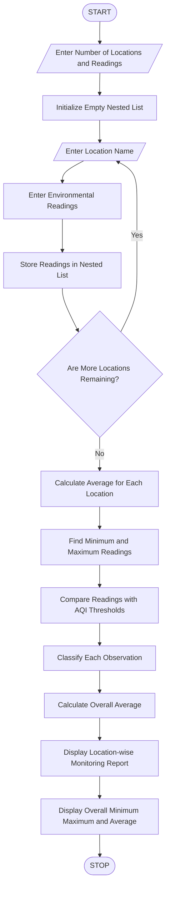

### Environmental Monitoring Data Analyzer – Python Program

### 1\. Problem Statement

The Environmental Monitoring Data Analyzer is designed to analyse environmental data such as air-quality or water-quality readings collected from multiple monitoring locations.

The program uses nested lists to store readings from different locations. It calculates average values, identifies minimum and maximum readings, and classifies observations according to predefined threshold values.

The program performs the following operations:

* Accepts the number of monitoring locations.

* Accepts the number of readings for each location.

* Stores environmental readings using nested lists.

* Calculates the average reading for each location.

* Identifies the minimum and maximum readings.

* Classifies readings based on supplied threshold values.

* Displays a complete environmental monitoring report.

Assumed classification rules for this program:

For this example, we use air-quality readings (AQI).

| AQI Range | Classification |
| --------- | -------------- |
| 0–50      | Good           |
| 51–100    | Moderate       |
| Above 100 | Poor           |

Formula:

Average Reading:

\\text{Average}=\\frac{\\text{Sum of Readings}}{\\text{Number of Readings}}

### 2\. Algorithm

* Start the program.

* Enter the number of monitoring locations.

* Enter the number of readings for each location.

* Initialize an empty nested list.

* For each monitoring location:

    * Enter the location name.

    * Enter environmental readings.

    * Store readings in a nested list.

* Calculate the average reading for each location.

* Identify the minimum and maximum readings.

* Classify each reading using the predefined AQI thresholds.

* Display the location-wise readings and classifications.

* Display the overall average, minimum and maximum readings.

* Stop the program.

### 3\. Flowchart



### 4\. Python Source Code

```python

# Environmental Monitoring Data Analyzer

# Input number of locations
n = int(input("Enter number of monitoring locations: "))

# Initialize nested list
locations = []
all_readings = []

# Collect environmental readings
for i in range(n):

    print("\nLocation", i + 1)

    name = input("Enter location name: ")

    count = int(input("Enter number of readings: "))

    readings = []

    for j in range(count):

        value = float(input("Enter AQI reading: "))

        readings.append(value)
        all_readings.append(value)

    locations.append([name, readings])

# Analyze environmental data
print("\n--- ENVIRONMENTAL MONITORING REPORT ---")

for location in locations:

    name = location[0]
    readings = location[1]

    average = sum(readings) / len(readings)

    minimum = min(readings)
    maximum = max(readings)

    print("\nLocation:", name)
    print("Readings:", readings)
    print("Average AQI:", round(average, 2))
    print("Minimum AQI:", minimum)
    print("Maximum AQI:", maximum)

    print("Classification:")

    for value in readings:

        if value <= 50:
            category = "Good"

        elif value <= 100:
            category = "Moderate"

        else:
            category = "Poor"

        print(value, "-", category)

# Overall analysis
overall_average = sum(all_readings) / len(all_readings)

overall_minimum = min(all_readings)
overall_maximum = max(all_readings)

print("\n--- OVERALL ENVIRONMENTAL SUMMARY ---")

print("Overall Average AQI:", round(overall_average, 2))
print("Overall Minimum AQI:", overall_minimum)
print("Overall Maximum AQI:", overall_maximum)

print("\nEnvironmental Analysis Completed.")
```

### 5\. Sample Input

```text
Enter number of monitoring locations: 2

Location 1
Enter location name: Vijayawada
Enter number of readings: 3
Enter AQI reading: 40
Enter AQI reading: 65
Enter AQI reading: 120

Location 2
Enter location name: Guntur
Enter number of readings: 3
Enter AQI reading: 35
Enter AQI reading: 80
Enter AQI reading: 95
```

### 6\. Sample Output

```text
--- ENVIRONMENTAL MONITORING REPORT ---

Location: Vijayawada
Readings: [40.0, 65.0, 120.0]
Average AQI: 75.0
Minimum AQI: 40.0
Maximum AQI: 120.0

Classification:
40.0 - Good
65.0 - Moderate
120.0 - Poor

Location: Guntur
Readings: [35.0, 80.0, 95.0]
Average AQI: 70.0
Minimum AQI: 35.0
Maximum AQI: 95.0

Classification:
35.0 - Good
80.0 - Moderate
95.0 - Moderate

--- OVERALL ENVIRONMENTAL SUMMARY ---

Overall Average AQI: 72.5
Overall Minimum AQI: 35.0
Overall Maximum AQI: 120.0

Environmental Analysis Completed.
```

### 7\. Conclusion

The Environmental Monitoring Data Analyzer efficiently processes air-quality readings collected from multiple locations. It calculates averages, identifies minimum and maximum values, and classifies observations using predefined thresholds.

This program demonstrates how Python can be used to organize and analyse environmental data.

Python concepts used:

* Variables and data types

* Nested lists

* `for` loops

* Nested `for` loops

* Conditional statements (`if`, `elif`, `else`)

* Arithmetic operators

* `append()` function

* `sum()` function

* `min()` function

* `max()` function

* `round()` function

Note: The AQI thresholds in this educational program are simplified assumptions. Actual air-quality classifications depend on the applicable monitoring standards and pollutant measurements. The program assumes at least one location and one reading per location.
