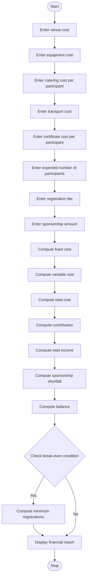

### Campus Event Financial Planning – Python Program

Level: B.Tech 1st Year Programming Language: Python

### 1. Problem Statement

The Campus Event Financial Planning System is designed to calculate and manage the expenses required to organize a college event.

The system accepts the following details:

* Venue cost

* Equipment cost

* Catering cost per participant

* Transport cost

* Certificate cost per participant

* Expected number of participants

* Registration fee per participant

* Sponsorship amount

The system calculates:

* Total event expenses.

* Total participant contributions.

* Total available sponsorship.

* Sponsorship shortfall, if any.

* Total event income.

* Profit or loss.

* Minimum number of registrations required to break even.

### 2. Algorithm

* Start the program.

* Enter venue cost.

* Enter equipment cost.

* Enter catering cost per participant.

* Enter transport cost.

* Enter certificate cost per participant.

* Enter expected number of participants.

* Enter registration fee per participant.

* Enter sponsorship amount.

* Calculate total fixed expenses:

Fixed Cost = Venue + Equipment + Transport

11. Calculate variable cost per participant:

Variable Cost = Catering + Certificate

12. Calculate total event cost:

Total Cost = Fixed Cost + (Variable Cost × Participants)

13. Calculate participant contributions:

Contributions = Registration Fee × Participants

14. Calculate total income:

Total Income = Contributions + Sponsorship

* Calculate sponsorship shortfall, if applicable.

* Calculate profit or loss.

* Calculate minimum registrations needed to break even.

* Display all financial details.

* Stop the program.

### 3. Flowchart




### 5. Sample Input

```text
Enter venue cost: 10000
Enter equipment cost: 5000
Enter catering cost per participant: 200
Enter transport cost: 3000
Enter certificate cost per participant: 50
Enter expected number of participants: 100
Enter registration fee per participant: 400
Enter sponsorship amount: 10000
```

### 6. Sample Output

```text
--- CAMPUS EVENT FINANCIAL REPORT ---

Fixed Cost: 18000.0
Variable Cost per Participant: 250.0
Total Event Cost: 43000.0

Participant Contributions: 40000.0
Sponsorship Amount: 10000.0

Sponsorship Shortfall: 0

Profit: 7000.0

Minimum Registrations Required: 33
```

