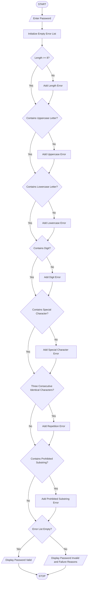

### Password Policy Validation Engine – Python Program

Level: B.Tech 1st Year Programming Language: Python

### 1\. Problem Statement

The Password Policy Validation Engine is designed to check whether a password satisfies predefined security rules.

The system accepts a password from the user and evaluates it based on the following conditions:

* Minimum Length: Password must contain at least 8 characters.

* Uppercase Letter: Password must contain at least one uppercase letter (A–Z).

* Lowercase Letter: Password must contain at least one lowercase letter (a–z).

* Digit: Password must contain at least one number (0–9).

* Special Character: Password must contain at least one special character (such as @, #, $, %).

* Repetition Rule: Password must not contain three consecutive identical characters.

* Prohibited Substring: Password must not contain prohibited words such as `password`, `admin`, or `123456`.

The program displays whether the password is valid or invalid and explains each failed condition.

### 2\. Algorithm

* Start the program.

* Enter a password.

* Initialize an empty list to store error messages.

* Check whether the password contains at least 8 characters.

* Check for at least one uppercase letter.

* Check for at least one lowercase letter.

* Check for at least one digit.

* Check for at least one special character.

* Check whether three consecutive characters are identical.

* Check whether the password contains prohibited substrings.

* If any condition fails, display the corresponding error messages.

* If all conditions pass, display "Password is Valid".

* Stop the program.

### 3\. Flowchart


### 4\. Python Source Code

```python

# Password Policy Validation Engine

password = input("Enter your password: ")

errors = []

# Rule 1: Minimum length
if len(password) < 8:
    errors.append("Password must contain at least 8 characters.")

# Rule 2: Uppercase letter
if not any(ch.isupper() for ch in password):
    errors.append("Password must contain an uppercase letter.")

# Rule 3: Lowercase letter
if not any(ch.islower() for ch in password):
    errors.append("Password must contain a lowercase letter.")

# Rule 4: Digit
if not any(ch.isdigit() for ch in password):
    errors.append("Password must contain at least one digit.")

# Rule 5: Special character
if not any(not ch.isalnum() for ch in password):
    errors.append("Password must contain a special character.")

# Rule 6: Repeated characters
repeated = False

for i in range(len(password) - 2):
    if password[i] == password[i+1] == password[i+2]:
        repeated = True
        break

if repeated:
    errors.append("Password must not contain 3 consecutive identical characters.")

# Rule 7: Prohibited substrings
prohibited = ["password", "admin", "123456"]

for word in prohibited:
    if word in password.lower():
        errors.append("Password contains a prohibited substring: " + word)

# Display result
print("\n--- PASSWORD VALIDATION RESULT ---")

if len(errors) == 0:
    print("Password is Valid!")
else:
    print("Password is Invalid.")
    print("\nFailed Conditions:")

    for error in errors:
        print("-", error)
```

### 5\. Sample Input

```text
Enter your password: hello123
```

### 6\. Sample Output

```text
--- PASSWORD VALIDATION RESULT ---

Password is Invalid.

Failed Conditions:
- Password must contain an uppercase letter.
- Password must contain a special character.
```

### 7\. Another Sample Input

```text
Enter your password: Hello@123
```

Output:

```text
--- PASSWORD VALIDATION RESULT ---

Password is Valid!
```

### 8\. Conclusion

The Password Policy Validation Engine checks passwords using predefined security conditions. It identifies invalid passwords and explains the reasons for failure.

This program demonstrates the use of Python strings, loops, conditional statements, lists, `any()` function and string methods.

Python concepts used:

* Variables and strings

* `if-else` statements

* `for` loop

* Lists and `append()`

* `len()` function

* `any()` function

* String methods (`isupper()`, `islower()`, `isdigit()`, `lower()`)

Suitable for B.Tech 1st Year Practical Record

Note: This is an educational password-validation program, not a complete production-level password security system.

