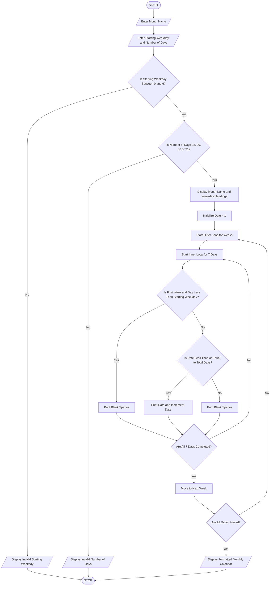

### Nested Loop Calendar Generator – Python Program

Level: B.Tech 1st Year Programming Language: Python

### 1\. Problem Statement

The Nested Loop Calendar Generator is designed to generate a formatted monthly calendar using the starting weekday and the total number of days in a month.

The program accepts the following inputs:

* Month name.

* Starting weekday (0 = Monday, 1 = Tuesday, ..., 6 = Sunday).

* Number of days in the month (28, 29, 30 or 31).

The program uses nested loops to arrange dates correctly under weekdays. It also checks whether the given number of days is valid.

Finally, it displays a properly aligned monthly calendar.

### 2\. Algorithm

* Start the program.

* Enter the month name.

* Enter the starting weekday (0–6).

* Enter the number of days in the month.

* Check whether the starting weekday is between 0 and 6.

* Check whether the number of days is 28, 29, 30 or 31.

* If the inputs are invalid, display an error message.

* Otherwise, display the weekday headings.

* Initialize the date as 1.

* Use an outer loop to print calendar weeks.

* Use an inner loop to print seven days in each week.

* Print blank spaces before the first date according to the starting weekday.

* Print dates in their correct positions.

* Continue until all dates are printed.

* Stop the program.

### 3\. Flowchart



### 4\. Python Source Code

```python

# Nested Loop Calendar Generator

# Input details
month = input("Enter month name: ")

start_day = int(input("Enter starting weekday (0=Mon, 6=Sun): "))

days = int(input("Enter number of days in month: "))

# Validate input
if start_day < 0 or start_day > 6:
    print("Invalid starting weekday!")

elif days not in [28, 29, 30, 31]:
    print("Invalid number of days!")

else:
    print("\n       ", month)
    print("Mon Tue Wed Thu Fri Sat Sun")

    date = 1

    # Outer loop for weeks
    for week in range(6):

        # Inner loop for days
        for day in range(7):

            # Print blank spaces before first date
            if week == 0 and day < start_day:
                print("    ", end="")

            # Print dates
            elif date <= days:
                print("%3d " % date, end="")
                date += 1

            else:
                print("    ", end="")

        print()

        # Stop when all dates are printed
        if date > days:
            break
```

### 5\. Sample Input

```text
Enter month name: November

Enter starting weekday (0=Mon, 6=Sun): 6

Enter number of days in month: 30
```

### 6\. Sample Output

```text
        November
Mon Tue Wed Thu Fri Sat Sun
                          1
  2   3   4   5   6   7   8
  9  10  11  12  13  14  15
 16  17  18  19  20  21  22
 23  24  25  26  27  28  29
 30
```

### 7\. Another Sample Input (Invalid Case)

```text
Enter month name: February

Enter starting weekday (0=Mon, 6=Sun): 8

Enter number of days in month: 28
```

Output:

```text
Invalid starting weekday!
```

### 8\. Conclusion

The Nested Loop Calendar Generator creates a properly formatted monthly calendar by using the starting weekday and the total number of days.

It uses nested loops to arrange dates into rows and columns, conditional statements to validate input, and formatting techniques to align the dates correctly.

Python concepts used:

* Variables and data types

* `input()` and `print()`

* Nested `for` loops

* `if-elif-else` statements

* Conditional operators

* `range()` function

* String formatting

Suitable for B.Tech 1st Year Practical Record

Note: This program validates the supplied weekday and month length, but it does not calculate weekdays automatically from a year. For February, both 28 and 29 days are accepted.

