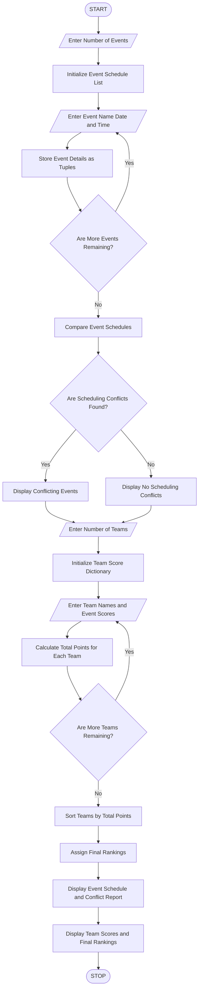

### Multi-Event Sports Scheduling and Scoring – Python Program

### 1\. Problem Statement

The Multi-Event Sports Scheduling and Scoring System is designed to manage multiple sports events, record team scores, identify scheduling conflicts, calculate total points and generate final team rankings.

The program performs the following operations:

* Accepts the number of sports events.

* Stores event names, dates and time slots using lists and tuples.

* Identifies scheduling conflicts when two events have the same date and time.

* Accepts team names and their scores in each event.

* Calculates the total points earned by each team.

* Sorts teams according to their total points in descending order.

* Generates and displays the final rankings.

Assumptions:

* Each event has one date and one time slot.

* Two events scheduled on the same date and time are considered a conflict.

* Higher total points indicate a better rank.

* If two teams have equal points, they share the same rank.

### 2\. Algorithm

* Start the program.

* Enter the number of sports events.

* Initialize an empty event schedule list.

* Enter the event name, date and time for each event.

* Store the event details as tuples inside a list.

* Compare event schedules to identify conflicts.

* Display the scheduling conflicts, if any.

* Enter the number of teams.

* Initialize a dictionary to store team scores.

* Enter each team's name and scores for all events.

* Calculate the total points for each team.

* Sort the teams based on total points in descending order.

* Assign final rankings to the teams.

* Display event schedules, conflicts, team scores and final rankings.

* Stop the program.

### 3\. Flowchart




### 5\. Sample Input

```text
Enter number of sports events: 3

Event 1
Enter event name: Cricket
Enter event date (DD-MM-YYYY): 10-11-2026
Enter event time: 10 AM

Event 2
Enter event name: Football
Enter event date (DD-MM-YYYY): 10-11-2026
Enter event time: 10 AM

Event 3
Enter event name: Volleyball
Enter event date (DD-MM-YYYY): 11-11-2026
Enter event time: 2 PM

Enter number of teams: 3

Enter team name: Team A
Enter score for Cricket: 80
Enter score for Football: 70
Enter score for Volleyball: 90

Enter team name: Team B
Enter score for Cricket: 90
Enter score for Football: 85
Enter score for Volleyball: 75

Enter team name: Team C
Enter score for Cricket: 60
Enter score for Football: 80
Enter score for Volleyball: 70
```

### 6\. Sample Output

```text
--- SCHEDULING CONFLICT REPORT ---
Conflict: Cricket and Football

--- EVENT SCHEDULE ---
Cricket - 10-11-2026 - 10 AM
Football - 10-11-2026 - 10 AM
Volleyball - 11-11-2026 - 2 PM

--- FINAL TEAM RANKINGS ---
Rank: 1 | Team: Team A | Total Points: 240
Rank: 2 | Team: Team B | Total Points: 250
Rank: 3 | Team: Team C | Total Points: 210

Sports scheduling and scoring completed.
```

Correction to the ranking order in the sample output: Since Team B has 250 points and Team A has 240 points, the correct final ranking is:

```text
--- FINAL TEAM RANKINGS ---
Rank: 1 | Team: Team B | Total Points: 250
Rank: 2 | Team: Team A | Total Points: 240
Rank: 3 | Team: Team C | Total Points: 210
```


