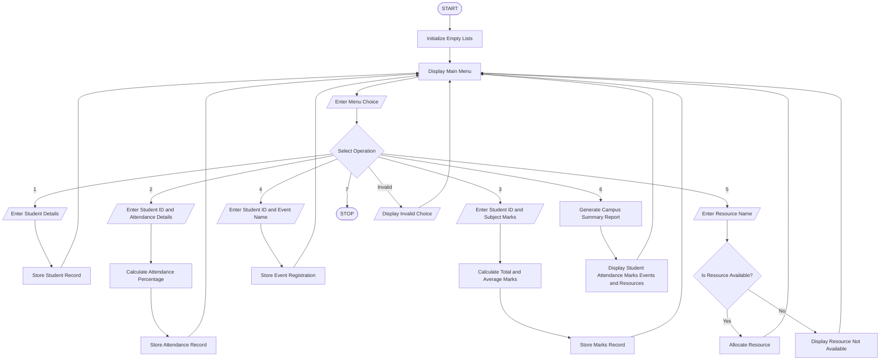

### Comprehensive Smart Campus Management Simulation – Python Program

### 1\. Problem Statement

The Comprehensive Smart Campus Management Simulation is a menu-driven Python application designed to manage different campus activities in one program.

The system integrates student records, attendance management, marks calculation, event registration, resource allocation and summary reporting.

The program performs the following operations:

* Student Records: Stores student ID, name, department and year.

* Attendance Management: Records the number of classes attended and conducted and calculates attendance percentage.

* Marks Management: Accepts marks in multiple subjects and calculates total and average marks.

* Event Registration: Allows students to register for campus events.

* Resource Allocation: Allocates available campus resources such as projectors, laboratories and seminar halls.

* Summary Reporting: Displays student details, attendance, marks, event registrations and allocated resources.

The program uses conditional statements, loops, strings, lists, nested lists, tuples and tuple unpacking.

### 2\. Algorithm

* Start the program.

* Initialize empty lists for student records, attendance, marks, events and resources.

* Display the main menu.

* Ask the user to select an operation.

* Perform the selected operation:

    * Option 1 – Add Student: Enter student ID, name, department and year. Store the details.

    * Option 2 – Attendance: Enter student ID, classes attended and total classes. Calculate attendance percentage.

    * Option 3 – Marks: Enter student ID and marks in three subjects. Calculate total and average.

    * Option 4 – Event Registration: Enter student ID and event name. Store the registration.

    * Option 5 – Resource Allocation: Enter resource name and allocate it if available.

    * Option 6 – Summary Report: Display all stored student information and campus activities.

    * Option 7 – Exit: Terminate the program.

* If the selected option is invalid, display an error message.

* Repeat the menu until the user selects Exit.

* Stop the program.

### 3\. Flowchart



### 4\. Python Source Code

```python

# Comprehensive Smart Campus Management Simulation

# Initialize lists
students = []
attendance = []
marks = []
registrations = []
resources = [
    ("Projector", 2),
    ("Laboratory", 1),
    ("Seminar Hall", 1)
]

while True:

    print("\n===== SMART CAMPUS MANAGEMENT =====")
    print("1. Add Student Record")
    print("2. Attendance Management")
    print("3. Marks Management")
    print("4. Event Registration")
    print("5. Resource Allocation")
    print("6. Summary Report")
    print("7. Exit")

    choice = input("Enter your choice: ")

    # 1. Student Records
    if choice == "1":

        sid = input("Enter Student ID: ")
        name = input("Enter Student Name: ")
        department = input("Enter Department: ")
        year = input("Enter Year: ")

        students.append((sid, name, department, year))

        print("Student record added successfully!")

    # 2. Attendance Management
    elif choice == "2":

        sid = input("Enter Student ID: ")
        attended = int(input("Enter classes attended: "))
        total = int(input("Enter total classes conducted: "))

        if total > 0 and 0 <= attended <= total:

            percentage = (attended / total) * 100

            attendance.append(
                (sid, attended, total, percentage)
            )

            print("Attendance Percentage:",
                  round(percentage, 2), "%")

        else:
            print("Invalid attendance details!")

    # 3. Marks Management
    elif choice == "3":

        sid = input("Enter Student ID: ")

        m1 = float(input("Enter Subject 1 marks: "))
        m2 = float(input("Enter Subject 2 marks: "))
        m3 = float(input("Enter Subject 3 marks: "))

        if all(0 <= m <= 100 for m in [m1, m2, m3]):

            total_marks = m1 + m2 + m3
            average = total_marks / 3

            marks.append(
                [sid, m1, m2, m3, total_marks, average]
            )

            print("Total Marks:", total_marks)
            print("Average Marks:", round(average, 2))

        else:
            print("Invalid marks! Enter marks between 0 and 100.")

    # 4. Event Registration
    elif choice == "4":

        sid = input("Enter Student ID: ")
        event = input("Enter Event Name: ")

        registrations.append((sid, event))

        print("Event registration successful!")

    # 5. Resource Allocation
    elif choice == "5":

        resource_name = input("Enter Resource Name: ")

        found = False

        for i in range(len(resources)):

            resource, available = resources[i]

            if resource.lower() == resource_name.lower():

                found = True

                if available > 0:

                    resources[i] = (resource, available - 1)

                    print(resource, "allocated successfully!")

                else:
                    print("Resource is not available!")

                break

        if not found:
            print("Resource not found!")

    # 6. Summary Report
    elif choice == "6":

        print("\n===== CAMPUS SUMMARY REPORT =====")

        print("\n--- STUDENT RECORDS ---")

        for sid, name, dept, year in students:
            print(sid, name, dept, year)

        print("\n--- ATTENDANCE DETAILS ---")

        for sid, attended, total, percentage in attendance:
            print(sid, attended, "/", total,
                  "Attendance:", round(percentage, 2), "%")

        print("\n--- MARKS DETAILS ---")

        for record in marks:
            sid, m1, m2, m3, total, average = record

            print(sid, "Total:", total,
                  "Average:", round(average, 2))

        print("\n--- EVENT REGISTRATIONS ---")

        for sid, event in registrations:
            print(sid, "registered for", event)

        print("\n--- RESOURCE AVAILABILITY ---")

        for resource, available in resources:
            print(resource, "Available:", available)

    # 7. Exit
    elif choice == "7":

        print("Exiting Smart Campus Management System.")
        break

    else:

        print("Invalid choice! Please try again.")
```

### 5\. Sample Input

The following is a simple example of entering student details, attendance, marks, event registration and resource allocation.

```text
===== SMART CAMPUS MANAGEMENT =====
1. Add Student Record
2. Attendance Management
3. Marks Management
4. Event Registration
5. Resource Allocation
6. Summary Report
7. Exit

Enter your choice: 1

Enter Student ID: 101
Enter Student Name: Ravi
Enter Department: CSE
Enter Year: 1

Student record added successfully!

Enter your choice: 2

Enter Student ID: 101
Enter classes attended: 45
Enter total classes conducted: 50

Attendance Percentage: 90.0 %

Enter your choice: 3

Enter Student ID: 101
Enter Subject 1 marks: 85
Enter Subject 2 marks: 90
Enter Subject 3 marks: 80

Total Marks: 255.0
Average Marks: 85.0

Enter your choice: 4

Enter Student ID: 101
Enter Event Name: Coding Competition

Event registration successful!

Enter your choice: 5

Enter Resource Name: Projector

Projector allocated successfully!

Enter your choice: 6
```

### 6\. Sample Output

```text
===== CAMPUS SUMMARY REPORT =====

--- STUDENT RECORDS ---
101 Ravi CSE 1

--- ATTENDANCE DETAILS ---
101 45 / 50 Attendance: 90.0 %

--- MARKS DETAILS ---
101 Total: 255.0 Average: 85.0

--- EVENT REGISTRATIONS ---
101 registered for Coding Competition

--- RESOURCE AVAILABILITY ---
Projector Available: 1
Laboratory Available: 1
Seminar Hall Available: 1

Enter your choice: 7

Exiting Smart Campus Management System.
```

### 7\. Conclusion

The Comprehensive Smart Campus Management Simulation provides a simple way to manage different college activities through a single menu-driven Python application.

It stores and processes student records, attendance, marks, event registrations and resource allocation. It also generates a summary report of campus activities.

Python concepts used:

* Variables and data types

* Conditional statements (`if`, `elif`, `else`)

* `while` and `for` loops

* Strings

* Lists

* Nested lists

* Tuples

* Tuple unpacking

* Dictionaries are not required in this version

* `break` statement

* `append()` and `round()` functions

* `all()` function

Note: This is a basic educational simulation. The records are stored in memory and will be cleared when the program exits. It does not use a database.
