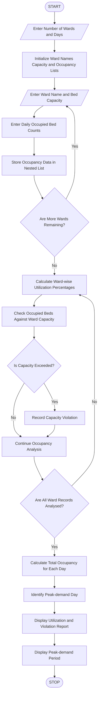

### Hospital Ward Occupancy Monitoring – Python Program

### 1\. Problem Statement

The Hospital Ward Occupancy Monitoring System is designed to analyse the number of occupied beds in different hospital wards over multiple days.

The program uses a nested list to store daily bed occupancy information for each ward. It calculates bed utilization percentages, identifies capacity violations and determines the peak-demand period.

The system performs the following operations:

* Accepts the number of hospital wards.

* Accepts the number of days to monitor.

* Stores daily bed occupancy counts using nested lists.

* Accepts the total bed capacity of each ward.

* Calculates the utilization percentage for each ward and day.

* Detects capacity violations when occupied beds exceed available beds.

* Identifies the day with the highest total bed occupancy.

* Displays a complete ward occupancy report.

Formula:

Bed Utilization Percentage:

\\text{Utilization} =
\\frac{\\text{Occupied Beds}}{\\text{Total Bed Capacity}}\\times100

Total Occupancy:

\\text{Total Occupancy} = \\sum \\text{Occupied Beds}

### 2\. Algorithm

* Start the program.

* Enter the number of hospital wards.

* Enter the number of days to monitor.

* Initialize empty lists for ward names, capacities and occupancy records.

* For each ward:

    * Enter the ward name.

    * Enter the total bed capacity.

    * Enter daily occupied bed counts.

    * Store daily occupancy counts in a nested list.

* Calculate utilization percentage for each ward and day.

* Check whether occupied beds exceed the ward capacity.

* Display capacity violations, if any.

* Calculate total occupied beds for each day.

* Identify the day with the highest total occupancy.

* Display ward-wise utilization percentages.

* Display the peak-demand period.

* Stop the program.

### 3\. Flowchart



### 4\. Python Source Code

```python

# Hospital Ward Occupancy Monitoring

# Input number of wards and days
wards = int(input("Enter number of wards: "))
days = int(input("Enter number of days: "))

ward_names = []
capacities = []
occupancy = []

# Collect ward details
for i in range(wards):

    print("\nWard", i + 1)

    name = input("Enter ward name: ")
    capacity = int(input("Enter total bed capacity: "))

    daily_occupancy = []

    for j in range(days):

        occupied = int(input("Enter occupied beds for Day " + str(j + 1) + ": "))

        daily_occupancy.append(occupied)

    ward_names.append(name)
    capacities.append(capacity)
    occupancy.append(daily_occupancy)

# Calculate utilization and detect violations
print("\n--- HOSPITAL WARD OCCUPANCY REPORT ---")

violations = []

for i in range(wards):

    print("\nWard:", ward_names[i])

    for j in range(days):

        occupied = occupancy[i][j]

        utilization = (occupied / capacities[i]) * 100

        print("Day", j + 1,
              "Occupied Beds:", occupied,
              "Utilization:", round(utilization, 2), "%")

        if occupied > capacities[i]:

            print("WARNING: Capacity Exceeded!")

            violations.append(
                (ward_names[i], j + 1, occupied)
            )

# Calculate total occupancy for each day
daily_totals = []

for j in range(days):

    total = 0

    for i in range(wards):

        total += occupancy[i][j]

    daily_totals.append(total)

# Identify peak-demand day
peak_occupancy = max(daily_totals)
peak_day = daily_totals.index(peak_occupancy) + 1

# Display capacity violations
print("\n--- CAPACITY VIOLATIONS ---")

if len(violations) == 0:

    print("No capacity violations found.")

else:

    for ward, day, count in violations:

        print(ward, "- Day", day,
              "- Occupied Beds:", count)

# Display daily occupancy totals
print("\n--- DAILY TOTAL OCCUPANCY ---")

for j in range(days):

    print("Day", j + 1, ":", daily_totals[j], "beds")

# Display peak demand
print("\n--- PEAK DEMAND ---")

print("Peak Demand Day:", peak_day)
print("Maximum Occupancy:", peak_occupancy, "beds")
```

### 5\. Sample Input

```text
Enter number of wards: 3
Enter number of days: 3

Ward 1
Enter ward name: General
Enter total bed capacity: 50
Enter occupied beds for Day 1: 40
Enter occupied beds for Day 2: 45
Enter occupied beds for Day 3: 55

Ward 2
Enter ward name: ICU
Enter total bed capacity: 20
Enter occupied beds for Day 1: 15
Enter occupied beds for Day 2: 18
Enter occupied beds for Day 3: 20

Ward 3
Enter ward name: Pediatric
Enter total bed capacity: 30
Enter occupied beds for Day 1: 20
Enter occupied beds for Day 2: 25
Enter occupied beds for Day 3: 28
```

### 6\. Sample Output

```text
--- HOSPITAL WARD OCCUPANCY REPORT ---

Ward: General
Day 1 Occupied Beds: 40 Utilization: 80.0 %
Day 2 Occupied Beds: 45 Utilization: 90.0 %
Day 3 Occupied Beds: 55 Utilization: 110.0 %
WARNING: Capacity Exceeded!

Ward: ICU
Day 1 Occupied Beds: 15 Utilization: 75.0 %
Day 2 Occupied Beds: 18 Utilization: 90.0 %
Day 3 Occupied Beds: 20 Utilization: 100.0 %

Ward: Pediatric
Day 1 Occupied Beds: 20 Utilization: 66.67 %
Day 2 Occupied Beds: 25 Utilization: 83.33 %
Day 3 Occupied Beds: 28 Utilization: 93.33 %

--- CAPACITY VIOLATIONS ---
General - Day 3 - Occupied Beds: 55

--- DAILY TOTAL OCCUPANCY ---
Day 1 : 75 beds
Day 2 : 88 beds
Day 3 : 103 beds

--- PEAK DEMAND ---
Peak Demand Day: 3
Maximum Occupancy: 103 beds
```

### 7\. Conclusion

The Hospital Ward Occupancy Monitoring System analyses daily bed occupancy across multiple hospital wards. It calculates utilization percentages, detects capacity violations and identifies the day with the highest demand.

This program demonstrates how Python can be used to organize and analyse hospital data efficiently.

Python concepts used:

* Variables and data types

* Nested lists

* `for` loops

* Nested `for` loops

* Conditional statements

* Arithmetic operators

* Tuples

* `append()` function

* `max()` function

* `index()` function

* `round()` function

Note: This is an educational simulation using sample occupancy data. In a real hospital, occupancy above capacity should be treated as an alert requiring staff review.
