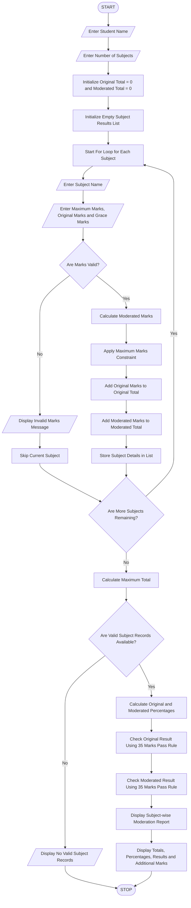

### University Examination Result Moderation – Python Program

Level: B.Tech 1st Year Programming Language: Python

### 1\. Problem Statement

The University Examination Result Moderation System is designed to process students' marks across multiple subjects and apply predefined moderation rules to improve examination results fairly.

The program accepts the following details:

* Student name.

* Number of subjects.

* Maximum marks for each subject.

* Original marks obtained in each subject.

* Moderation marks to be added.

The system performs the following operations:

* Accepts original marks for multiple subjects.

* Applies moderation marks to each subject.

* Ensures that moderated marks do not exceed the maximum marks.

* Calculates original total and moderated total.

* Calculates original and moderated percentages.

* Determines the result before and after moderation.

* Displays a comparison of original and moderated results.

Formula:

Moderated Marks:

\\text{Moderated Marks}=\\min(\\text{Original Marks}+\\text{Grace Marks},\\text{Maximum Marks})

Original Percentage:

\\frac{\\text{Original Total}}{\\text{Maximum Total}}\\times100

Moderated Percentage:

\\frac{\\text{Moderated Total}}{\\text{Maximum Total}}\\times100

### 2\. Algorithm

* Start the program.

* Enter the student name.

* Enter the number of subjects.

* Initialize original and moderated totals to zero.

* For each subject:

    * Enter subject name.

    * Enter maximum marks.

    * Enter original marks.

    * Enter moderation marks.

* Validate the entered marks.

* Calculate moderated marks using the maximum-mark constraint.

* Add original marks to the original total.

* Add moderated marks to the moderated total.

* Repeat until all subjects are processed.

* Calculate original and moderated percentages.

* Check whether the student passed before moderation.

* Check whether the student passed after moderation.

* Display original and moderated marks, totals, percentages and results.

* Stop the program.

Assumed rules for this program:

* Minimum pass mark: 35 per subject.

* Maximum moderation: 5 marks per subject.

* Moderated marks cannot exceed maximum marks.

### 3\. Flowchart




### 5\. Sample Input

```text
Enter student name: Ravi
Enter number of subjects: 3

Subject 1
Enter subject name: Maths
Enter maximum marks: 100
Enter original marks: 32
Enter moderation marks: 5

Subject 2
Enter subject name: Physics
Enter maximum marks: 100
Enter original marks: 75
Enter moderation marks: 5

Subject 3
Enter subject name: Chemistry
Enter maximum marks: 100
Enter original marks: 90
Enter moderation marks: 5
```

### 6\. Sample Output

```text
--- EXAMINATION MODERATION REPORT ---

Student Name: Ravi

Subject  Original  Moderated  Maximum
Maths       32        37         100
Physics     75        80         100
Chemistry   90        95         100

Original Total: 197
Moderated Total: 212

Original Percentage: 65.67 %
Moderated Percentage: 70.67 %

Original Result: FAIL
Moderated Result: PASS

Additional Marks: 15
```

valid subject entries, so the report is based only on valid entries.
